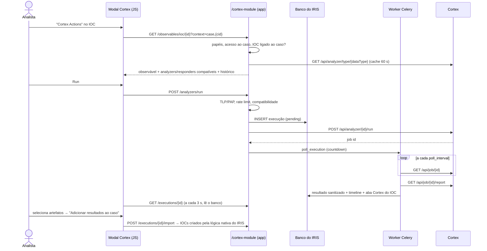

# iris-cortex-module

**Integração DFIR-IRIS ⇄ Cortex.** Execute **Analyzers** e **Responders** do Cortex a partir de IOCs,
evidências, arquivos do datastore, casos e alertas, sem sair do IRIS. Resultados, histórico e auditoria
ficam associados ao caso ou alerta de origem.

| | |
|---|---|
| **Versão** | 1.0.0 |
| **Compatível com** | DFIR-IRIS **v2.4.29** · Cortex **3.1.x** (validado com 3.1.8) e **4.x** (API do 4.1.0) |
| **Licença** | LGPL-3.0-or-later |
| **Testes** | 79 unitários + 18 de integração (IRIS real + Cortex simulado) + validação funcional com Cortex 3.1.8 real |

Análise técnica e decisões de arquitetura: [docs/ARCHITECTURE.md](docs/ARCHITECTURE.md).

---

## Sumário

1. [Funcionalidades](#1-funcionalidades)
2. [Como funciona](#2-como-funciona)
3. [Instalação](#3-instalação)
4. [Preparação do Cortex](#4-preparação-do-cortex)
5. [Ativação e configuração no IRIS](#5-ativação-e-configuração-no-iris)
6. [Controle de acesso (RBAC)](#6-controle-de-acesso-rbac)
7. [Uso pelo analista](#7-uso-pelo-analista)
8. [Tipos de dados](#8-tipos-de-dados)
9. [API REST](#9-api-rest)
10. [Auditoria e timeline](#10-auditoria-e-timeline)
11. [Segurança](#11-segurança)
12. [Solução de problemas](#12-solução-de-problemas)
13. [Cortex local para testes](#13-cortex-local-para-testes)
14. [Testes](#14-testes)
15. [Desenvolvimento e evolução](#15-desenvolvimento-e-evolução)
16. [Limitações conhecidas](#16-limitações-conhecidas)

---

## 1. Funcionalidades

- **Cortex Actions** nos menus nativos de **IOC** (tabela e modal do IOC, inclusive dentro de alertas),
  **evidência**, **caso** e **alerta**.
- **Analyzers compatíveis** com o tipo do observável listados automaticamente, com descrição, versão, autor e
  disponibilidade. Vários analyzers podem ser executados de uma vez.
- **Responders compatíveis** com o objeto (`thehive:case_artifact`, `thehive:case`, `thehive:alert`), com
  **confirmação obrigatória** e destaque dos responders de **contenção**.
- **Jobs assíncronos**: o worker do IRIS acompanha os jobs e a interface nunca fica bloqueada.
- **Resultado legível**: status, data/hora, job ID, **taxonomias** coloridas por nível, **resumo** em
  chave/valor, **resultado completo** navegável e o **JSON** retornado.
- **Enriquecimento seletivo**: os artefatos encontrados são validados e o analista escolhe quais viram IOCs
  (**Adicionar resultados ao caso**). Nada é importado automaticamente.
- **Operações de responders** aplicáveis no IRIS: `AddTagToArtifact`, `AddTagToCase`, `AddTagToAlert`, `CreateTask`.
- **Aba "Cortex" no IOC** com o último resultado de cada analyzer, visível na tela nativa do IOC.
- **Timeline** ("Cortex Analyzer executed" / "Cortex Responder executed"), **histórico do alerta**, feed de
  atividades e tabela de **auditoria** completa.
- **Histórico de execuções** por objeto e por caso/alerta.
- **RBAC** próprio (`cortex.view`, `cortex.analyzer.execute`, `cortex.responder.execute`,
  `cortex.responder.privileged`, `cortex.admin`) baseado em grupos do IRIS.
- **Política de TLP/PAP**, **multi-tenant** (uma organização do Cortex por cliente do IRIS), rate limit e
  allow/deny-lists de analyzers.

## 2. Como funciona



Se a task de polling se perder (restart do worker, broker fora do ar), dois mecanismos retomam o job:
- um reconciliador periódico (a cada minuto, pelo *beat* do worker);
- a própria consulta da interface, que avança o job diretamente.

## 3. Instalação

O módulo usa o mesmo patch genérico de extensões web do `iris-email-module`
(`docker/0001-iris-v2.4.29-web-extensions-loader.patch`). O Dockerfile só o aplica se ele ainda não estiver presente.

### 3.1 Docker (recomendado)

```bash
cd iris-web                        # v2.4.29
echo "IRIS_CORTEX_API_KEY='<api-key-do-usuario-iris-no-cortex>'" >> .env
chmod 600 .env

export IRIS_CORTEX_MODULE_PATH=../iris-cortex-module
docker compose -f docker-compose.yml -f $IRIS_CORTEX_MODULE_PATH/docker/docker-compose.cortex.yml up -d --build
```

**Junto com o iris-email-module:** construa primeiro a imagem do e-mail e empilhe a do Cortex sobre ela.

```bash
IRIS_CORTEX_BASE_IMAGE=iriswebapp_app_email:v2.4.29 docker compose -f docker-compose.yml \
  -f ../iris-email-module/docker/docker-compose.email.yml \
  -f ../iris-cortex-module/docker/docker-compose.cortex.yml up -d --build
```

Confira no log:

```bash
docker logs iriswebapp_app 2>&1 | grep "Loaded web extension iris_cortex_module"
docker logs iriswebapp_worker 2>&1 | grep -E "iris_cortex_module\.(poll_execution|reconcile)"
```

> O `app` e o `worker` precisam usar a **mesma imagem**: é o worker que acompanha os jobs.

### 3.2 Manual

No ambiente Python do IRIS (app **e** worker): `pip install /caminho/iris-cortex-module`, aplique o patch
(se ainda não aplicado) e reinicie os dois processos.

## 4. Preparação do Cortex

1. Crie (ou use) uma **organização** para o IRIS.
2. Crie um usuário dedicado, por exemplo `iris`, **somente com os papéis `read` e `analyze`**.
   > Nunca use `orgadmin` ou `superadmin`: com essas chaves o Cortex devolve a configuração dos analyzers,
   > que inclui as API keys de VirusTotal, Shodan e outros. O módulo descarta esses campos, mas o princípio do
   > menor privilégio vale. A tela de status do módulo avisa se a chave for de administrador.
3. Gere a API key do usuário e coloque-a no ambiente do IRIS (`IRIS_CORTEX_API_KEY`, ou `IRIS_CORTEX_API_KEY_FILE`
   para Docker/K8s secrets). Recrie `app` e `worker`.
4. Habilite na organização os analyzers e responders desejados. Em cada analyzer, mantenha `check_tlp`/`max_tlp`
   coerentes com a política do IRIS.

**Multi-tenant (MSSP):** crie uma organização por cliente e aponte cada cliente do IRIS para a variável da chave
correspondente:

```json
{"Cliente A": "CORTEX_KEY_CLIENTE_A", "Cliente B": "CORTEX_KEY_CLIENTE_B"}
```

## 5. Ativação e configuração no IRIS

1. **Advanced > Modules > Add module** → `iris_cortex_module`.
2. Configure pelo menos `cortex_url` e clique em **Enable module**.
3. O item **Cortex Actions** aparece nos menus de IOC, evidência, caso e alerta.

Todos os parâmetros podem ser fixados por variável de ambiente `IRIS_CORTEX_<NOME_EM_MAIÚSCULAS>`, e o ambiente
tem prioridade. Mudanças feitas na tela valem imediatamente.

### Conexão

| Parâmetro | Padrão | Descrição |
|---|---|---|
| `cortex_url` | — | URL do Cortex, ex.: `https://cortex.empresa.com:9001`. **Obrigatório.** |
| `cortex_api_key_env` | `IRIS_CORTEX_API_KEY` | **Nome** da variável de ambiente com a API key. **Não é a chave.** `<NOME>_FILE` também é lido. |
| `customer_api_keys` | `{}` | JSON `{"cliente IRIS": "NOME_DA_VARIAVEL"}` para multi-tenant. |
| `verify_tls` / `ca_file` | `true` / — | Verificação do certificado do Cortex e CA própria. |
| `timeout` | `30` | Timeout de cada requisição, em segundos. |
| `max_retries` | `3` | Tentativas em leituras (rede, 429, 5xx). **Execuções nunca são repetidas automaticamente.** |
| `poll_interval` | `10` | Intervalo entre consultas ao job, em segundos. |
| `job_timeout` | `900` | Depois desse tempo, a execução é marcada como `timeout`. |

### Escopo

| Parâmetro | Padrão | Descrição |
|---|---|---|
| `enable_for_iocs` / `_evidences` / `_files` / `_cases` / `_alerts` | `true` | Onde o Cortex é oferecido. |
| `datatype_mapping` | `{}` | Sobrescreve a conversão IRIS → Cortex, ex.: `{"mutex": "other"}`. |
| `analyzer_allowlist` / `analyzer_denylist` | — | Padrões de nome (`virustotal*`, `*_3_0`). |
| `responder_allowlist` | — | Padrões de nome dos responders oferecidos. |

### Classificação

| Parâmetro | Padrão | Descrição |
|---|---|---|
| `max_tlp` | `amber` | Observáveis acima deste TLP **nunca** são enviados (`clear`, `green`, `amber`, `amber+strict`, `red`). |
| `max_pap` / `default_pap` | `amber` / `amber` | O IRIS não tem campo PAP: `default_pap` é enviado em todos os observáveis. |

### RBAC, limites e comportamento

| Parâmetro | Padrão | Descrição |
|---|---|---|
| `groups_view`, `groups_analyzer`, `groups_responder`, `groups_responder_privileged`, `groups_admin` | — | Ver seção 6. |
| `privileged_responders` | `*block*,*isolat*,*quarantin*,*contain*,*disable*,*delete*,*kill*,*ban*,*revoke*,*reset*` | Responders de contenção/destrutivos. |
| `max_analyzers_per_request` | `10` | |
| `rate_limit_analyzer_user_hour` / `rate_limit_responder_user_hour` | `100` / `20` | `0` desativa. |
| `max_observable_length` | `8192` | Caracteres. |
| `max_file_size_mb` | `25` | Arquivos do datastore enviados a analyzers de arquivo. |
| `max_report_kb` | `2048` | Relatórios maiores são guardados truncados (com aviso). |
| `max_artifacts_import` | `50` | Por importação. |
| `force_run` | `false` | Envia `force=1`, ignorando o cache de jobs do Cortex. |
| `write_ioc_tab` | `true` | Mantém a aba "Cortex" no IOC. |
| `add_timeline_event` | `true` | Evento na timeline do caso a cada execução. |

## 6. Controle de acesso (RBAC)

O IRIS tem um conjunto fixo de permissões. Por isso os papéis do módulo são mapeados para **grupos do IRIS**, e
as duas camadas valem ao mesmo tempo:

1. **Acesso ao objeto** (regras nativas): acesso total ao caso para executar (leitura para visualizar), ou
   `alerts_write`/`alerts_read` + acesso ao cliente do alerta.
2. **Papel `cortex.*`** (grupos configurados no módulo).

| Papel | Permite | Parâmetro | Se vazio |
|---|---|---|---|
| `cortex.view` | ver catálogo, resultados, histórico | `groups_view` | todos com acesso ao objeto |
| `cortex.analyzer.execute` | executar analyzers, importar artefatos | `groups_analyzer` | todos com **escrita** no objeto |
| `cortex.responder.execute` | responders não privilegiados, aplicar operações | `groups_responder` | **ninguém** (só admin) |
| `cortex.responder.privileged` | responders em `privileged_responders` | `groups_responder_privileged` | **ninguém** (só admin) |
| `cortex.admin` | tudo + auditoria completa | `groups_admin` | administradores do servidor IRIS |

Exemplo típico de SOC:

```
groups_analyzer             = SOC N1, SOC N2, IR
groups_responder            = SOC N2, IR
groups_responder_privileged = IR
```

## 7. Uso pelo analista

1. Em um **caso**, na tabela de IOCs (menu ⋮ da linha ou ação em lote), no modal de um IOC, na tabela de evidências
   ou nas ações rápidas do caso; ou em um **alerta** (menu do card ou menu de um IOC do alerta), clique em
   **Cortex Actions**.
2. O topo do modal mostra o **observável**, o **tipo** (IRIS → Cortex) e o **TLP**. IOCs compostos
   (`filename|sha256`, `domain|ip`) geram um seletor com cada parte. Aberto a partir do caso ou do alerta, o modal
   permite escolher qualquer IOC, evidência ou arquivo do contexto.
3. **Analyzers**: clique em **Run** ou marque vários e use **Executar selecionados**. Os bloqueados mostram o
   motivo (TLP, permissão, somente leitura).
4. **Responders**: clique em **Run**. A confirmação mostra o responder, o objeto e a ação. Responders de contenção
   aparecem em vermelho com um aviso adicional.
5. O resultado aparece abaixo das abas e se atualiza sozinho: status, taxonomias, resumo, artefatos, operações,
   resultado completo e JSON.
6. **Adicionar resultados ao caso**: marque os artefatos desejados e confirme. Eles viram IOCs com tag `cortex`,
   descrição de origem e TLP nunca menor que o do observável original.
7. **Histórico de execuções**: todas as execuções do objeto ou do caso/alerta, com acesso a cada resultado.

## 8. Tipos de dados

Conversão dos 160 tipos de IOC do IRIS (taxonomia MISP) para os tipos do Cortex:

| IRIS | Cortex |
|---|---|
| `ip-dst`, `ip-src`, `ip-any`, `ip-*\|port` | `ip` |
| `domain` | `domain` |
| `hostname`, `hostname\|port` | `fqdn` |
| `url`, `link` | `url` |
| `uri` | `uri_path` |
| `md5`, `sha1`, `sha224`, `sha256`, `sha384`, `sha512`, `sha3-*` | `hash` |
| `email`, `email-src`, `email-dst`, `email-reply-to`, `target-email`… | `mail` |
| `email-subject` | `mail_subject` |
| `filename`, `email-attachment` | `filename` |
| `filename\|<hash>` | `filename` **e** `hash` |
| `domain\|ip` | `domain` **e** `ip` |
| `user-agent` | `user-agent` |
| `AS` | `autonomous-system` |
| `regkey`, `regkey\|value` | `registry` |
| demais | `other` (ajustável em `datatype_mapping`) |

| Objeto | Observáveis | Responders |
|---|---|---|
| IOC | conforme a tabela acima | `thehive:case_artifact` |
| Evidência | `hash` (se o hash for MD5/SHA-1/SHA-256…) e `filename` | `thehive:case_artifact` |
| Arquivo do datastore | `file` (upload) e `hash` (SHA-256) | — |
| Caso | — | `thehive:case` (com os IOCs como `artifacts`) |
| Alerta | — | `thehive:alert` (com os IOCs como `artifacts`) |

Os valores são **validados antes do envio** (IP, domínio, URL http/https/ftp, hash hexadecimal de tamanho
conhecido, e-mail, AS). Valores inválidos não são enviados, e o motivo aparece no modal.

**Arquivos protegidos:** o IRIS guarda arquivos marcados como IOC em zip com senha. O módulo extrai o conteúdo em
memória, com limite de tamanho, e envia o arquivo original ao analyzer.

## 9. API REST

Autenticação padrão do IRIS: sessão (com `csrf_token` no corpo de POSTs) ou `Authorization: Bearer <api-key>`.

| Método | Rota | Descrição |
|---|---|---|
| GET | `/cortex-module/status` | Conectividade, versão, organização, papéis do usuário. |
| GET | `/cortex-module/observables/{ioc\|evidence\|file\|case\|alert}/{id}?context_type=&context_id=` | Observável, analyzers/responders compatíveis, histórico. |
| POST | `/cortex-module/analyzers/run` | `{kind, object_id, context_type, context_id, observable_index, analyzer_ids[]}` |
| POST | `/cortex-module/responders/run` | `{kind, object_id, context_type, context_id, responder_id, confirm: true, request_uuid}` |
| GET | `/cortex-module/executions/{id}` | Estado atual (lido do banco). |
| GET | `/cortex-module/executions/{id}/report` | Inclui o resultado completo. |
| POST | `/cortex-module/executions/{id}/import` | `{indexes: [..]}` → IOCs. |
| POST | `/cortex-module/executions/{id}/operations/{index}/apply` | Aplica uma operação de responder. |
| GET | `/cortex-module/history/{case\|alert}/{id}` | Execuções do contexto. |
| GET | `/cortex-module/logs?status=&worker_type=&context_type=&context_id=&object_kind=&user_login=&worker=&page=&per_page=` | Auditoria (`cortex.admin`). |

```bash
KEY=...; IRIS=https://iris.empresa.com
curl -s -H "Authorization: Bearer $KEY" \
  "$IRIS/cortex-module/observables/ioc/42?context_type=case&context_id=7"
curl -s -H "Authorization: Bearer $KEY" -H 'Content-Type: application/json' "$IRIS/cortex-module/analyzers/run" \
  -d '{"kind":"ioc","object_id":42,"context_type":"case","context_id":7,"analyzer_ids":["<id do analyzer>"]}'
```

Códigos: `400` validação ou incompatibilidade · `403` permissão, TLP ou objeto fora de acesso · `404` objeto fora do
contexto · `409` requisição repetida ou operação já aplicada · `413` requisição grande · `429` rate limit (IRIS ou
Cortex) · `502` erro de autenticação ou resposta inesperada do Cortex · `503` Cortex indisponível ou módulo
desativado/mal configurado · `504` timeout.

## 10. Auditoria e timeline

Cada execução gera um registro em `iris_cortex_execution`:

| Grupo | Campos |
|---|---|
| Quem / quando | `user_id`, `user_login`, `client_ip`, `is_from_api`, `created_at`, `finished_at` |
| Onde | `context_type`, `context_id`, `customer_id`, `customer_name`, `object_kind`, `object_id`, `object_label` |
| O quê | `worker_type`, `worker_id`, `worker_name`, `worker_version`, `privileged`, `data_type`, `observable`, `tlp`, `pap` |
| Enviado | `request_payload` (inclui o objeto TheHive enviado a responders), `cortex_url`, `cortex_job_id` |
| Resultado | `status`, `cortex_status`, `verdict`, `taxonomies`, `highlights`, `report`, `artifacts`, `operations`, `imported` |
| Erros | `error_message` (para o analista), `error_detail` (técnico) |

**Timeline do caso**, por exemplo:

```
Cortex Analyzer executed: TorProject_1_0 on 185.220.101.10

Analyzer: TorProject_1_0 1.0
Observable: 185.220.101.10
Type: ip
TLP: GREEN
Status: success
Verdict: suspicious
Taxonomies: TorProject:Node=True (suspicious)
Job ID: lfBi66ABj0G2B5C6oGWK
Executed by: administrator
Timestamp: 2026-09-29 04:17:54 UTC
Audit record: #10
```

O evento é vinculado ao IOC analisado. Em alertas, a mesma informação vai para o histórico do alerta. Importações e
operações aplicadas também são registradas nas atividades. A tabela não tem chaves estrangeiras: o registro
sobrevive à exclusão do caso, do alerta ou do usuário.

## 11. Segurança

| Tema | Controle |
|---|---|
| API key | Só em variável de ambiente/secret. Nunca gravada, logada ou devolvida. Chave digitada no campo errado é recusada sem ser exibida. |
| Segredos dos analyzers | Lista fechada de campos em workers e jobs: `configuration` nunca chega ao IRIS. Aviso quando a chave é de administrador. |
| RBAC | Duas camadas (objeto + papel). Responders negados por padrão. Contenção exige papel específico. |
| Contexto | O objeto precisa pertencer ao caso/alerta informado (sem acesso cruzado por ID). A mesma resposta para "não existe" e "sem acesso". |
| TLP/PAP | Política própria antes do envio. `amber+strict` tratado como RED. |
| Responders | Confirmação obrigatória (`confirm: true`), `request_uuid` contra duplicidade, rate limit próprio. |
| Resultados | Tratados como dados não confiáveis: limites de profundidade, tamanho e itens, remoção de caracteres de controle, exibição só como texto, HTML da aba do IOC escapado (e sanitizado de novo pelo IRIS). |
| Artefatos | Validação de tipo e valor (`javascript:` e outros são recusados), deduplicação, limite por importação, TLP nunca rebaixado. |
| Arquivos | Limite de tamanho, extração do zip em memória com limite de descompressão. |
| Parâmetros | IDs de analyzer/job validados (sem path injection). Corpo JSON limitado a 256 KB. |
| Rede | Retry com backoff só em leituras. Redirects recusados. Resposta do Cortex limitada a 20 MB. |
| Indisponibilidade | Erros tipados com mensagem clara. Catálogo e histórico continuam abrindo com o Cortex fora do ar. |

## 12. Solução de problemas

| Sintoma | Causa provável | Solução |
|---|---|---|
| "API key do Cortex não configurada" | Variável vazia no contêiner. | Defina `IRIS_CORTEX_API_KEY` no `.env` e recrie `app` e `worker`. |
| "cortex_api_key_env must be the NAME…" | A chave foi digitada no campo do nome da variável. | Coloque `IRIS_CORTEX_API_KEY` no campo e a chave no `.env`. Troque a chave no Cortex. |
| "API key do Cortex inválida" | Chave revogada ou de outro Cortex. | Gere outra para o usuário `iris`. |
| "Cortex indisponível" | URL, DNS, firewall ou Cortex parado. | `docker exec iriswebapp_app python -c "import urllib.request;print(urllib.request.urlopen('<cortex_url>/api/status').read())"` |
| "Falha na validação TLS" | CA interna. | `ca_file` com a CA, ou `verify_tls=false` só em laboratório. |
| Nenhum analyzer listado | Nenhum analyzer habilitado na organização para aquele tipo, ou filtrado pelas listas. | Habilite no Cortex e confira `analyzer_allowlist`/`denylist`. |
| Analyzer "Bloqueado: TLP" | TLP do IOC acima de `max_tlp`. | Comportamento esperado. Ajuste o TLP do IOC ou a política, conscientemente. |
| Responders sempre bloqueados | Deny-by-default. | Configure `groups_responder` / `groups_responder_privileged`. |
| Execução fica "Na fila" | Worker parado ou sem o módulo. | Confira `docker logs iriswebapp_worker` (tasks `iris_cortex_module.*`). O reconciliador e a interface retomam o job. |
| Job falha com erro do analyzer | Erro do próprio analyzer (chave do serviço, cota, TLP). | A mensagem do Cortex aparece no resultado e na timeline. |
| `PGRES_TUPLES_OK and no message from the libpq` no worker | Conexões de banco herdadas no fork do Celery. | Corrigido pelo módulo (`worker_process_init`). Confirme `DB pool reset in worker process` no log. |
| Responder em contêiner não alcança um serviço do compose | Os jobs do Cortex rodam na rede bridge padrão. | Use um endereço alcançável a partir do host (ex.: `host.docker.internal` no Docker Desktop). |

## 13. Cortex local para testes

`docker/cortex-local/` sobe um **Cortex 3.1.8 real** (com Elasticsearch 7.17) ligado à rede do IRIS e habilita
analyzers gratuitos.

```bash
cd docker/cortex-local
cp .env.example .env      # ajuste CORTEX_JOBS_HOST_DIR (caminho sem espaços, compartilhado com o Docker) e CORTEX_SECRET
docker compose up -d
python3 bootstrap.py      # migração, admin, organização SOC, socadmin, usuário iris (read/analyze), analyzers
# recrie app e worker do IRIS para carregar a IRIS_CORTEX_API_KEY escrita no iris-web/.env
```

- Interface: http://localhost:9001. Logins e senhas gerados ficam em `docker/cortex-local/.credentials` (permissão 600).
- No IRIS: `cortex_url = http://cortex:9001`.
- Analyzers habilitados: Abuse_Finder, DShield_lookup, TorProject, CIRCLHashlookup, FileInfo, EmlParser,
  GoogleDNS_resolve, Robtex (IP e PDNS). Responder: Mailer, enviando para o Mailpit do `iris-email-module`
  (destinatário via tag `mail=<endereço>` no caso).
- O bootstrap pode ser executado de novo: ele mantém usuários e senhas e só gera nova API key com `--renew-key`.

Validação funcional executada com esse ambiente: TorProject, DShield, Abuse_Finder e CIRCLHashlookup executados a partir
do IRIS com resultados reais, e o responder Mailer enviando o e-mail do caso ao Mailpit.

> Ambiente de desenvolvimento: Elasticsearch sem autenticação e Cortex em HTTP. Não use em produção.

## 14. Testes

```bash
python -m venv .venv && .venv/bin/pip install -e '.[test]'
.venv/bin/pytest                          # 79 unitários; integração é pulada sem IRIS
```

Os testes unitários sobem um **Cortex simulado** (`tests/mock_cortex/server.py`) com o formato de resposta do
Cortex 4.1. Ele devolve de propósito uma `configuration` com um segredo falso, para provar que ele nunca atravessa
o cliente.

**Integração (IRIS real + Cortex simulado):**

```bash
echo 'IRIS_CORTEX_MOCK_API_KEY=test-key' >> ../iris-web/.env
cd ../iris-web && docker compose -f docker-compose.yml -f ../iris-cortex-module/docker/docker-compose.cortex.yml \
  --profile cortextest up -d --build        # recria app/worker e sobe o mock-cortex
cd ../iris-cortex-module
IRIS_URL=https://127.0.0.1 IRIS_VERIFY_TLS=false IRIS_API_KEY=<api-key-admin> IRIS_CASE_ID=1 IRIS_ALERT_ID=<id> \
  .venv/bin/pytest tests/integration -v
```

A suíte aponta o módulo para o simulador durante a execução e **restaura a configuração anterior** no fim. Ela
cobre catálogo, ausência de segredos, tipos compostos, evidências, isolamento de contexto, execução assíncrona,
sucesso e falha, timeline, aba do IOC, importação seletiva, política de TLP, confirmação e idempotência de
responders, operações, responder de caso, contexto de alerta, histórico, auditoria, RBAC com um analista
não-admin, multi-tenant, Cortex indisponível e chave digitada no campo errado.

## 15. Desenvolvimento e evolução

```
iris_cortex_module/
├── IrisCortexInterface.py      módulo IRIS: parâmetros + "Cortex Actions"
├── core/                       sem IRIS/Flask
│   ├── settings.py             parâmetros, env, API key, allow/deny, privilegiados
│   ├── client.py               cliente da API do Cortex
│   ├── datatypes.py            tipos IRIS ⇄ Cortex, validação, TLP
│   ├── observables.py          observáveis e entidades TheHive
│   ├── policy.py               papéis cortex.* e política TLP/PAP
│   └── results.py              parser, sanitização, artefatos, operações, HTML da aba
├── integration/                IRIS v2.4
│   ├── access.py · observables_db.py · service.py · jobs.py · audit.py
│   ├── models.py · config_store.py · routes.py · extension.py · errors.py
└── static/iris_cortex.{js,css} modal
docker/  Dockerfile · docker-compose.cortex.yml · mock-cortex.Dockerfile · cortex-local/
tests/   unitários · mock_cortex/ · integration/
```

Pontos de extensão já previstos (ver [ARCHITECTURE.md §6](docs/ARCHITECTURE.md)):
- **Enrichment automático:** hook `on_postload_ioc_create` chamando `service.run_analyzers` com um perfil.
- **Analyzer profiles / execução sequencial:** `analyzers/run` já aceita listas.
- **Aprovação de responders:** status `awaiting_approval`.
- **Score de reputação e correlação:** taxonomias normalizadas.
- **Playbooks / SOAR:** o `service` é chamável sem HTTP, como o worker já faz.

Regras: `core/` nunca importa IRIS/Flask; código compatível com Python 3.9
(`vermin -t=3.9- --eval-annotations iris_cortex_module`); ao mudar o JS, incremente `MODULE_VERSION`.

## 16. Limitações conhecidas

- **IRIS v2.4.29 apenas.** Para o v3, reaproveite `core/` e reescreva `integration/` e o modal.
- **Responders sobre arquivos** (`file`) não são oferecidos. A análise de arquivos é suportada.
- **Operações** suportadas: `AddTagToArtifact`, `AddTagToCase`, `AddTagToAlert`, `CreateTask`. As demais
  (`AddCustomFields`, `CloseTask`, `MarkAlertAsRead`…) são exibidas, mas não aplicadas.
- **Parâmetros de execução** (`parameters`) não são expostos na interface. Poucos analyzers os usam.
- **Artefatos de arquivo** retornados por analyzers não são importados.
- **Cortex 4.x** foi validado contra a API do código-fonte 4.1.0 e o simulador. A execução real foi com o 3.1.8.
- A interface do modal foi validada pelos testes de integração e pela verificação da injeção do script. A checagem
  visual em navegador é manual.
- O rate limit é contado no banco, e requisições simultâneas bem no limite podem ultrapassá-lo por pouco.

## Licença

LGPL-3.0-or-later ([LICENSE](LICENSE), [COPYING](COPYING)). Módulo independente, não mantido pelas equipes do
DFIR-IRIS ou do Cortex/StrangeBee.
